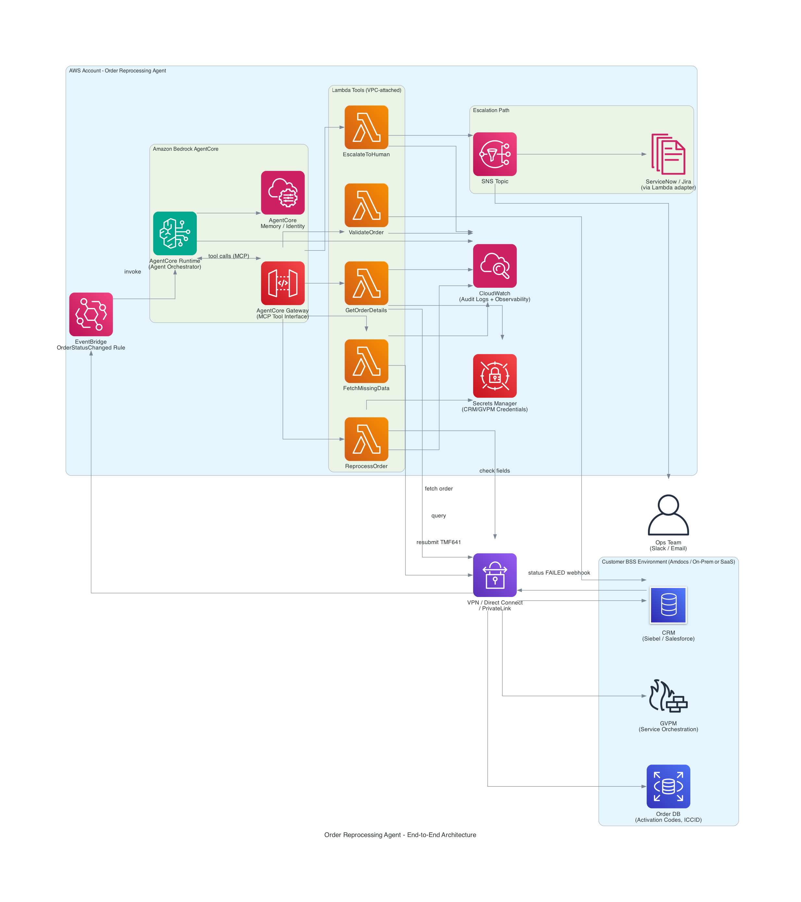
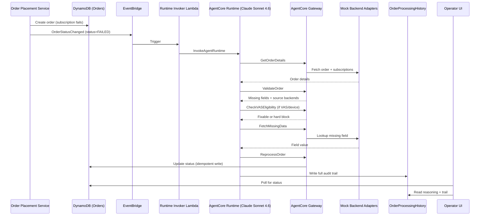

# Autonomous Order Processing Failure Detection and Correction for BSS Telco

Autonomous order failure detection and correction for telco Business Support Systems, powered by Amazon Bedrock AgentCore + Claude Sonnet 4.6.

## Overview

When a telco customer's order fails — a missing activation code, a device stuck in backorder, a VAS partner provisioning error — the Order Reprocessing Agent autonomously detects the failure, investigates the correct backend system, retrieves the missing data, and resubmits the order for activation. When it genuinely can't resolve an issue safely (a hard business-rule block, a persistent backend error), it escalates to a human with a full written diagnosis — all within seconds to a couple of minutes, with zero manual triage.

This solution runs a real [Strands Agents](https://strandsagents.com/) SDK agent on **Amazon Bedrock AgentCore Runtime**, calling 6 purpose-built tools through an **AgentCore Gateway** (MCP), against a realistic mock telco Business Support System backend layer.

## The Problem

Order failures in a telco BSS require investigating multiple, siloed backend systems before a fix is even possible:

- **Multiple backend systems, no single view** — CRM, eSIM provisioning, SIM/device inventory, VAS partner APIs (Netflix, Spotify, Disney+), billing profile, number portability — each with its own failure modes, and none of them talk to each other
- **Manual triage is slow** — an operator has to check each backend by hand, decide whether the issue is fixable, fetch the missing data, and manually resubmit the order
- **Real revenue and customer impact** — every stuck order is a customer who paid for a new line, device, or streaming bundle that hasn't activated
- **Not every failure should be auto-fixed** — a licensing region-lock or a trade-in valuation dispute is a business decision, not a data problem; a system that always tries to "fix" everything will eventually fabricate data it shouldn't

## The Solution: An Agent That Knows When to Act — and When Not To

The Order Reprocessing Agent follows a strict, auditable decision sequence:

| Step | Tool | What It Does |
|---|---|---|
| 1 | `GetOrderDetails` | Fetches the full order and every subscription line item |
| 2 | `ValidateOrder` | Identifies every missing/invalid field, and which backend owns it |
| 3 | `CheckVASEligibility` | For VAS/device items: is this genuinely fixable, or a hard business-rule block? |
| 4 | `FetchMissingData` | Retrieves one missing field from the correct backend adapter (retries once on transient error) |
| 5 | `ReprocessOrder` | Resubmits the corrected subscription item — idempotent by design, safe against duplicate events |
| 6 | `EscalateToHuman` | Creates a ticket with full reasoning, only when the agent cannot safely proceed |

The agent's system prompt enforces one non-negotiable rule: **never fabricate a field value — only use values returned by `FetchMissingData`.** For a system that touches real customer orders, a plausible-sounding hallucinated ICCID or activation code is worse than an honest escalation.

## Benefits

**1. Autonomous resolution, not just alerting**
The agent doesn't just flag a failed order — it fetches the missing data and resubmits it. A missing activation code goes from `FAILED` to `ACTIVATED` with no human touch.

**2. Honest partial success**
A multi-line order (mobile line + device + streaming bundle) doesn't succeed or fail as one atomic unit. If the device is backordered but the line and VAS add-on activate fine, the order correctly reports `PARTIALLY_ACTIVATED` — not a false failure, not a false success.

**3. Knows when NOT to act**
`CheckVASEligibility` lets the agent distinguish "I can fix this by fetching data" from "this is a business decision requiring a human" — and skip straight to escalation for the latter, instead of wasting fetch attempts or fabricating a value.

**4. A real, structured audit trail**
Every tool writes its action to an append-only `OrderProcessingHistory` table at the exact moment it acts — not reconstructed from logs afterward. Every escalation includes the agent's full written reasoning.

**5. A safety net beyond the prompt**
A Bedrock Guardrail, scoped specifically to `ReprocessOrder` — the one tool that takes a real state-changing action — adds a layer of protection against invalid or hallucinated data reaching a downstream system, independent of the system prompt's own instructions.

**6. Idempotent by design**
`ReprocessOrder` uses conditional DynamoDB writes, so a duplicate EventBridge delivery or Lambda retry can never cause a duplicate resubmission — verified directly against the live deployment.

## Architecture



EventBridge detects the order failure and invokes the AgentCore Runtime, which reasons with Claude Sonnet 4.6 and calls its 6 tools through the AgentCore Gateway (MCP). Tools read/write order state and fetch missing data from backend systems; when the agent can't safely proceed, it escalates via SNS to the ops team and a ticketing system, with every step recorded for audit.

### End-to-End Sequence



## Components

### Lambda Functions (`src/agent/tools/`, `src/mock_backends/`, `src/order_placement_service/`)

| Function | Purpose |
|---|---|
| `ora-order-placement-service` | Creates orders, determines Realistic/Demo Mode outcome |
| `ora-runtime-invoker` | Bridges EventBridge `OrderStatusChanged` events to AgentCore Runtime invocation |
| `ora-tool-get-order-details` | Agent tool: fetch full order + subscriptions |
| `ora-tool-validate-order` | Agent tool: identify missing/invalid fields |
| `ora-tool-fetch-missing-data` | Agent tool: resolve one missing field from the correct backend |
| `ora-tool-reprocess-order` | Agent tool: idempotent resubmission |
| `ora-tool-escalate-to-human` | Agent tool: ticket creation + full reasoning capture |
| `ora-adapter-*` (12 functions) | Mock backend systems: eSIM, SIM/number/device inventory, IMEI registry, Netflix/Spotify/Disney+, billing profile, GVPM, ticketing |
| `ora-failure-injection-engine` | Determines Realistic/Demo Mode failure outcomes for placed orders |
| `ora-ambient-activity-generator` | Simulates background customer order activity |

### Data Model (DynamoDB)

| Table | Purpose |
|---|---|
| `ora-crm-orders` | Parent order records |
| `ora-crm-order-subscriptions` | Per-line-item subscription state (Mobile Line, Device, VAS) |
| `ora-order-processing-history` | Append-only audit trail — every tool action, every agent reasoning text |
| `ora-device-inventory` | Mock device stock/financing state |

### Operator UI (`src/ui/`)

A local Streamlit app with 5 tabs: **Trigger** (place orders, force scenarios, watch live resolution), **Order Summary**, **Issues** (escalated/partial worklist), **Agent Trace**, **Order History** (full per-order audit trail with rendered agent reasoning).

## Tested Scenarios (Verified Against a Real Deployment)

| Scenario | Trigger | Agent Behavior | Outcome |
|---|---|---|---|
| Missing activation code | `missing_activation_code` | Fetches from eSIM Provisioning DB, resubmits | `ACTIVATED` |
| Device stock backorder | `stock_backorder` | Other subscription items activate independently | `PARTIALLY_ACTIVATED` |
| VAS region lock | `region_lock` | `CheckVASEligibility` recognizes hard block, escalates immediately (no wasted fetch) | `ESCALATED` |
| Trade-in valuation dispute | `trade_in_valuation_mismatch` | Same immediate-escalation pattern | `ESCALATED` |
| VAS entitlement failure | `entitlement_failure` | Retries transient partner API failure, resubmits | `ACTIVATED` |
| Multi-subscription combo | Realistic Mode, complex order | Diagnoses and resolves each subscription item independently within one order | Mixed, resolved per item |

All scenarios were exercised end-to-end against a real AWS deployment (account-scoped, region eu-west-2) — real EventBridge events, a real AgentCore Runtime invocation, real Claude Sonnet 4.6 reasoning, real DynamoDB state transitions.

## AWS Services Used

| Service | Purpose |
|---|---|
| Amazon Bedrock AgentCore | Runtime (hosts the agent) + Gateway (exposes tools via MCP) |
| Amazon Bedrock | Claude Sonnet 4.6 inference + Guardrail |
| AWS Lambda | All tool, adapter, and orchestration compute (~22 functions) |
| Amazon DynamoDB | Orders, subscriptions, audit history, device inventory |
| Amazon EventBridge | Real-time failure detection (rule + scheduler for ambient activity) |
| AWS CDK | Infrastructure as code for the full stack |

## Getting Started

### Prerequisites
- AWS account with Bedrock model access for Claude Sonnet 4.6
- Python 3.13+, AWS CDK CLI, Docker (for the AgentCore Runtime container build)

### Deployment
```bash
pip install -e ".[dev,ui]"
cdk deploy --app "python infrastructure/app.py" \
  -c environment=Demo -c owner=<alias> -c costCenter=<cost-center> -c operatingMode=DEMO
python -m mock_backends.seed.seed_crm
streamlit run src/ui/app.py
```

See [`docs/deployment-guide.md`](docs/deployment-guide.md) for full prerequisites, verification steps, and troubleshooting, and [`docs/cleanup-runbook.md`](docs/cleanup-runbook.md) for teardown (several resources use a RETAIN removal policy by design).

## Repository Structure

```
├── README.md
├── pyproject.toml
├── infrastructure/          # CDK stack definitions
│   └── cdk_constructs/      # Agent orchestration, tools, mock backend layer, order placement
├── src/
│   ├── agent/
│   │   ├── runtime/         # Strands Agent entrypoint, system prompt, Gateway client
│   │   ├── tools/            # The 6 agent tools
│   │   ├── gateway/          # Tool registration
│   │   └── guardrails/       # ReprocessOrder guardrail config
│   ├── mock_backends/
│   │   ├── adapters/         # 12 mock backend systems
│   │   ├── failure_injection_engine/
│   │   └── seed/             # CRM seed data generator
│   ├── order_placement_service/  # Order creation, ambient activity, runtime invoker
│   └── ui/                   # Streamlit Operator UI
├── tests/                     # Unit + integration + e2e tests
└── docs/
    ├── deployment-guide.md
    └── cleanup-runbook.md
```

## Authors

Ali Ahmed Shaikh - Technical Account Manager
Ankur Sinha - Technical Account Manager
